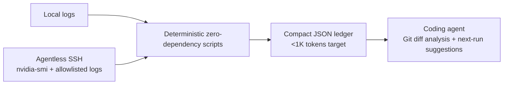

# TrainLens

**English** | [简体中文](README_zh.md)


[](LICENSE)

Zero-intrusion, read-only AI training experiment ledger & root-cause lens for Coding Agents (local + agentless SSH).

Give TrainLens a directory of training runs. It ranks the runs and identifies their recorded best checkpoints, shows which settings changed, and reports the step and evidence for each detected anomaly. Coding agents can read the same results as compact JSON. For a PR or a lab meeting, export a Markdown or standalone HTML report.

## Why TrainLens?

The comparison starts with a training job that already produces logs. The choice depends on which records you have and whether you also need live experiment tracking.

| Capability | Raw Coding Agent | W&B | MLflow | TensorBoard | TrainLens |
| --- | --- | --- | --- | --- | --- |
| Training-code changes | Can inspect existing files | Framework integration or SDK | Autologging or logging API | Can open existing event files | Reads five existing log families |
| Install on the training host | Depends on tools the agent invokes | Previously tracked runs can be inspected elsewhere | Previously tracked runs can be queried elsewhere | Event files can be viewed elsewhere | Existing SSH, Python for logs, `nvidia-smi` for GPU telemetry |
| Read binary `tfevents` with Python's standard library | Requires a decoder | TensorBoard integration | Depends on the ingestion workflow | TensorBoard event reader and its dependencies | Bundled TFRecord / Protobuf scalar reader |
| Low-token experiment ledger | Depends on prompt and parser | JSON summaries of local `.wandb` records | Select run fields through the tracking API | Scalar series and dashboards | Compact JSON with status, best step and anomalies |
| Config Diff + Git attribution | Agent assembles the evidence | Run configs and Git metadata | Logged parameters and Git tags | HParams dashboard for logged parameters | Changed config keys, recorded SHAs and changed file names when commits resolve locally |
| Read-only by construction | Depends on the tool permissions | Inspect runs or write tracking records | Query runs or write tracking records | Viewer reads events produced by a writer | Experiment inputs and training processes stay read-only |

For the tracking workflows and their data models, see [W&B](https://github.com/wandb/wandb), [W&B CLI releases](https://github.com/wandb/wandb/releases), [MLflow Tracking](https://mlflow.org/docs/latest/ml/tracking/), [TensorBoard](https://www.tensorflow.org/tensorboard/get_started), and the [HParams dashboard](https://www.tensorflow.org/tensorboard/hyperparameter_tuning_with_hparams).

## Architecture



The <1K-token target applies to small ledgers. With `o200k_base`, the default three-run `scan_runs.py` output measured **959 tokens** for `llm-sft` and **1,034 tokens** for `mmseg-cityscapes`, including the trailing newline. Run count, path length, fields and tokenizer all affect the result. Use `scan_runs.py --limit` to cap scan rows or `compare_runs.py --top-k` to cap ranking rows.

## Installation

**CLI.** Run the scripts from a checkout with Python 3.9 or newer. All five CLIs use the standard library. The offline quickstart needs only the repository and Python.

```sh
python3 skills/trainlens/scripts/scan_runs.py --help
```

**Codex.** Send this prompt to Codex to install TrainLens.

```text
$skill-installer Install the skill at skills/trainlens from the GitHub repository LowmistLMT/trainlens.
```

To add the skill to a project manually, copy the entire `skills/trainlens` directory. From this checkout, the following command installs it into the same project's Codex skill directory.

```sh
mkdir -p .agents/skills
cp -R skills/trainlens .agents/skills/
```

| Agent | Project-local destination |
| --- | --- |
| Codex | `.agents/skills/trainlens/` |
| Claude Code | `.claude/skills/trainlens/` |
| Cursor | `.cursor/skills/trainlens/` |
| OpenCode | `.opencode/skills/trainlens/` |

Keep `SKILL.md`, `scripts/`, `references/` and `assets/` together. In Codex, try “Use $trainlens to compare the SFT runs by eval_loss and tell me which checkpoint to keep.” See the [skill instructions](skills/trainlens/SKILL.md), [Codex skills](https://developers.openai.com/codex/skills/), [Claude Code skills](https://code.claude.com/docs/en/skills), [Cursor skills](https://cursor.com/docs/skills), and [OpenCode skills](https://opencode.ai/docs/skills/).

## 30-second offline quickstart

Run these commands from the repository root. Both bundled datasets contain three runs. The scan, comparison, diagnosis and SSH commands default to one JSON line with `schema_version`, `tool`, `ok`, `summary`, `data` and `warnings`. Choose `--format md` for tables or `--pretty` for indented JSON.

```sh
scripts=skills/trainlens/scripts
demo=skills/trainlens/assets/demo-logs
python3 "$scripts/scan_runs.py" "$demo/llm-sft"
```

### 1. Hugging Face SFT — choose a checkpoint and investigate a failure

```sh
python3 "$scripts/compare_runs.py" "$demo/llm-sft" --config-diff --format md
python3 "$scripts/diagnose.py" "$demo/llm-sft" --format md
```

Compared 3 run(s) by eval_loss (min).

| Rank | Run | Framework | Status | Step | Best | Best step | Last | Δ vs best | Checkpoint | Commit |
| --- | --- | --- | --- | --- | --- | --- | --- | --- | --- | --- |
| 1 | sft_lora_r32_best | hf | completed | 600 | 0.94 | 600 | 0.94 | 0.0 | checkpoint-600 | e7f8a9b |
| 2 | sft_baseline | hf | completed | 600 | 1.12 | 500 | 1.15 | 0.18 | checkpoint-500 | a1b2c3d |
| 3 | sft_lr5e4_nan | hf | crashed | 250 | 1.88 | 100 | 1.88 | 0.94 | checkpoint-100 | d4e5f6a |

**Config Diff** (table from the comparison output)

| Key | sft_baseline | sft_lora_r32_best | sft_lr5e4_nan |
| --- | --- | --- | --- |
| bf16 | true | true | false |
| fp16 | false | false | true |
| learning_rate | 0.0001 | 0.00015 | 0.0005 |
| lora_alpha | 32 | 64 | 32 |
| lora_r | 16 | 32 | 16 |
| max_grad_norm | 1.0 | 1.0 | 0.0 |
| warmup_ratio | 0.05 | 0.08 | 0.01 |
| weight_decay | 0.01 | 0.02 | 0.01 |

Diagnosed 3 run(s), found 3 issue(s).

| Run | Severity | Code / playbook | Step | Evidence |
| --- | --- | --- | --- | --- |
| sft_baseline | warning | OVERFITTING | 600 | eval_loss 1.12 (step 500) -> 1.15, loss 0.95 (step 500) -> 0.89 (step 600) |
| sft_lr5e4_nan | critical | NAN_LOSS | 250 | loss=NaN |
| sft_lr5e4_nan | critical | GRAD_EXPLOSION | 200 | grad_norm=142.7 exceeds 50 |

The baseline checkpoint at step 500 has lower validation loss than its final checkpoint. Its best loss is 0.18 above the leader. For the crashed run, the first gradient spike precedes the NaN by 50 steps. The changed learning rate, precision and clipping settings are candidates for a controlled rerun.

### 2. MMSegmentation — compare class IoU and inspect an OOM

```sh
python3 "$scripts/compare_runs.py" "$demo/mmseg-cityscapes" --config-diff --per-class --format md
python3 "$scripts/diagnose.py" "$demo/mmseg-cityscapes" --format md
```

The ranking and per-class table below are excerpts from the comparison output. The best mIoU is 3.83 points above baseline at step 36000. The per-class table uses each run's final observation. Pass a baseline run as the first path to select it explicitly.

Compared 3 run(s) by mIoU (max).

| Rank | Run | Framework | Status | Step | Best | Best step | Last | Δ vs best | Checkpoint | Commit |
| --- | --- | --- | --- | --- | --- | --- | --- | --- | --- | --- |
| 1 | segformer_b2_aug | mmengine | completed | 40000 | 78.65 | 36000 | 78.4 | 0.0 | best_mIoU_iter_36000.pth | 445566b |
| 2 | segformer_b0_base | mmengine | completed | 40000 | 74.82 | 36000 | 74.68 | -3.83 | best_mIoU_iter_36000.pth | 112233a |
| — | segformer_b2_bs16_oom | mmengine | crashed | 1000 | — | — | — | — | — | 778899c |

**Per-class metrics (last value and Δ vs segformer_b0_base)**

| Metric | segformer_b0_base | segformer_b2_aug | segformer_b2_bs16_oom |
| --- | --- | --- | --- |
| IoU.building | 91.8 (0.0) | 92.9 (1.1) | — |
| IoU.car | 93.7 (0.0) | 94.9 (1.2) | — |
| IoU.person | 78.2 (0.0) | 82.9 (4.7) | — |
| IoU.pole | 56.5 (0.0) | 62.9 (6.4) | — |
| IoU.road | 97.7 (0.0) | 98.1 (0.4) | — |
| IoU.sidewalk | 82.7 (0.0) | 86.0 (3.3) | — |

Diagnosed 3 run(s), found 1 issue(s).

| Run | Severity | Code / playbook | Step | Evidence |
| --- | --- | --- | --- | --- |
| segformer_b2_bs16_oom | critical | CUDA_OOM | 1000 | torch.cuda.OutOfMemoryError: CUDA out of memory. Tried to allocate 2.40 GiB. GPU 0 has a total capacity of 23.65 GiB of which 512.00 MiB is free. (step is last logged) |

## Agentless SSH

For a GPU server already configured as `gpu-lab` in your SSH client, replace the remote path below with its experiment root. The GPU query reads utilization, allocated VRAM, temperature and power. Log inspection uses the host's existing `python3` to read allowlisted files into a temporary local snapshot.

```sh
python3 "$scripts/ssh_fetch.py" --host gpu-lab --gpu
python3 "$scripts/ssh_fetch.py" --host gpu-lab --remote-dir /srv/training/runs --gpu --logs --format md
```

The default cap is 2 MiB per file. Larger structured files are skipped with a warning. Each text log contributes up to its last 200 lines within the byte cap. Use `--max-bytes` to change the cap or `--cache-dir` to retain a private snapshot locally.

## Export a report

```sh
python3 "$scripts/render_report.py" "$demo/llm-sft" --title "SFT checkpoint review"
python3 "$scripts/render_report.py" "$demo/mmseg-cityscapes" --per-class --include-git --output cityscapes.html
```

The first command previews Markdown on stdout. The second writes a self-contained HTML file outside the experiment tree. A `.md` destination produces a Markdown file. With `--include-git`, add `--repo /path/to/training-repo` to inspect local HEAD, working-tree state and file changes between recorded commits. Use `--template` to adapt the [report template](skills/trainlens/assets/report-template.md).

## Supported logs

| Family | Input examples | Extracted data |
| --- | --- | --- |
| Hugging Face Trainer, TRL, LLaMA-Factory | `trainer_state.json` at the run root or in a checkpoint | Step history, eval loss, recorded best checkpoint |
| MMEngine / MMSegmentation | `vis_data/scalars.json`, `*.log.json` | mIoU, per-class `IoU.*`, best checkpoint filename |
| Ultralytics | `results.csv` and `args.yaml` | Epoch metrics including `metrics/mAP50-95(B)` |
| TensorBoard | `events.out.tfevents.*` | Scalar `simple_value` and scalar float/double tensor summaries |
| Generic CSV / JSONL | `metrics.csv`, `metrics.jsonl` | Numeric metric series with detected step or epoch |

See the [format reference](skills/trainlens/references/log-formats.md) for file layouts and metric directions.

## Diagnostic rules

| Code | Default trigger |
| --- | --- |
| `NAN_LOSS` | A loss metric contains NaN or infinity. |
| `GRAD_EXPLOSION` | Gradient norm is non-finite, above 50, or above both 15 and 10× its preceding median. |
| `CUDA_OOM` | A log tail matches a CUDA/HIP allocation error or a recognized NCCL failure signature. Inspect the evidence for the exact message. |
| `STALLED_LOG` | An unfinished run with a known step target has gone more than 30 minutes without a log update. |
| `OVERFITTING` | Validation loss rebounds more than 1.5% from its best point while training loss drops over that interval. |
| `LOSS_PLATEAU` | The range of the last five training-loss values is below 0.0001. |
| `IDLE_GPU_BURN` | An SSH GPU sample shows utilization below 5% with at least 10% of VRAM allocated. |

`diagnose.py` reports the six training-log rules. The GPU rule comes from `ssh_fetch.py --gpu` and describes a single sample. Each training finding includes the affected run, severity, step, evidence and [playbook](skills/trainlens/references/failure-playbooks.md).

## Safety

The inspection commands open experiment logs and checkpoint metadata for reading. SSH runs a fixed GPU query and an allowlisted file reader. Training processes, checkpoints and training code remain under the operator's control. Git provenance uses read-only repository queries. Files created by TrainLens are local snapshots and explicitly requested reports outside the experiment inputs.

## Roadmap

Candidates for v0.2 include opt-in webhook notifications and Slurm / DeepSpeed log support.

## Tests and license

```sh
python3 -B -S -m unittest discover -s tests -v
```

The test suite also runs under pytest. TrainLens is distributed under the [MIT License](LICENSE).
