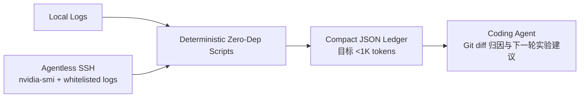

# TrainLens

[English](README.md) | **简体中文**


[](LICENSE)

Zero-intrusion, read-only AI training experiment ledger & root-cause lens for Coding Agents (local + agentless SSH).

TrainLens 把已有训练日志整理成编程智能体可以直接读取的实验账本。想知道「哪次训练的验证损失最低」或「哪次训练从哪一步开始异常」，可以直接查到对应的指标、训练步和 checkpoint，再结合配置差异与 Git 提交追查原因。本地 CLI 使用 Python 3.9+ 标准库。

## 为什么用 TrainLens

如果训练已经开始或结束，手上有日志，怎样把实验差异交给编程智能体？下表对照各工具处理已有记录的方式，并区分查看结果和写入跟踪数据所需的权限。

| 能力 | Raw Coding Agent（直接读文件） | W&B | MLflow | TensorBoard | TrainLens |
| --- | --- | --- | --- | --- | --- |
| 零训练代码侵入 | 可读已有日志 | 可查已有 W&B run，采集新的 run 通常用 SDK 或框架集成 | 可查已跟踪的实验，也可启用 autolog | 可打开已有 event 文件 | 直接读已有日志 |
| 训练机零额外安装 | 取决于智能体可用工具 | 可在本机查看或同步拷回的 W&B run | 可从客户端访问已有跟踪服务 | 可在本机打开拷回的日志 | 已有 SSH 与远端 Python 即可读日志，GPU 查询使用已有的 `nvidia-smi` |
| 纯标准库解析二进制 tfevents | 需自行实现或调用工具 | 由集成和 SDK 处理 | 由日志集成或外部工具处理 | 使用 TensorBoard 自身的事件读取器 | 原生解码 TFRecord 与 Protobuf 标量 |
| 低 Token 实验账本 | 需自行提取与压缩 | 可查 run 配置与指标摘要 | 可检索 run 并选择指标、参数 | 可通过标量与插件查看指标 | 默认单行 JSON，含最佳值、对应步数与异常 |
| Config Diff + Git 归因线索 | 可分别检查配置和 Git | 可比较 runs，并查看已记录的代码版本 | 可比较 runs，查询参数与已记录的来源信息 | HParams 可比较超参，提交需另行关联 | 仅列变化的超参，可读取已记录的提交并对照本地 Git |
| 架构级只读 | 取决于授权的工具 | 跟踪与同步可写入 run | 跟踪 API 支持写入 run | 可只读查看已有日志，写入 event 由训练侧完成 | 训练目录和进程只读，报告与缓存另存 |

各工具的原生查询与展示方式可参见 [W&B CLI](https://github.com/wandb/wandb/blob/main/wandb/cli/cli.py)、[MLflow Tracking API](https://mlflow.org/docs/latest/ml/tracking/tracking-api) 和 [TensorBoard HParams](https://www.tensorflow.org/tensorboard/hyperparameter_tuning_with_hparams)。

## 架构



`<1K tokens` 是小型账本的压缩目标。本机按 `o200k_base` 计数，默认 `scan_runs.py` 的单行 JSON（含末尾换行）在 `llm-sft` Demo 上是 959 tokens，在 `mmseg-cityscapes` 上是 1034 tokens。分词器、路径长度和返回字段都会影响结果，可用 `--limit` 控制返回的实验数。

## 安装

**直接运行 CLI。** 在仓库根目录执行以下命令即可查看扫描器的用法。运行时依赖全部来自 Python 标准库。

```sh
python3 skills/trainlens/scripts/scan_runs.py --help
```

**在 Codex 中使用。** 把下面这句发给 Codex 即可安装 TrainLens。

```text
$skill-installer 请从 GitHub 仓库 LowmistLMT/trainlens 安装 skills/trainlens 目录中的技能。
```

也可以从克隆的仓库根目录，把整个技能目录复制到当前项目。

```sh
mkdir -p .agents/skills
cp -R skills/trainlens .agents/skills/
```

| 智能体 | 目标项目中的技能目录 |
| --- | --- |
| Codex | `.agents/skills/trainlens/` |
| Claude Code | `.claude/skills/trainlens/` |
| Cursor | `.cursor/skills/trainlens/` |
| OpenCode | `.opencode/skills/trainlens/` |

目录内应直接包含 `SKILL.md`、`scripts/`、`assets/` 和 `references/`。各工具的目录发现规则见 [Codex](https://developers.openai.com/codex/skills/)、[Claude Code](https://code.claude.com/docs/en/skills)、[Cursor](https://cursor.com/docs/skills) 和 [OpenCode](https://opencode.ai/docs/skills/)。

安装后可以用自然语言提问，例如「用 TrainLens 比较这三个 SFT 实验的 eval_loss，指出最佳 checkpoint 和出现梯度异常的训练步」。

## 30 秒离线快速上手

从仓库根目录开始。两组 Demo 各包含三次实验，直接运行，无需下载模型、数据集或启动训练。

```sh
SKILL=skills/trainlens
SCRIPTS="$SKILL/scripts"
SFT="$SKILL/assets/demo-logs/llm-sft"
SEG="$SKILL/assets/demo-logs/mmseg-cityscapes"
python3 "$SCRIPTS/scan_runs.py" "$SFT" --format md
```

### 按 eval_loss 选择 Hugging Face SFT 的 checkpoint

```sh
python3 "$SCRIPTS/compare_runs.py" "$SFT" --metric eval_loss --config-diff --format md
python3 "$SCRIPTS/diagnose.py" "$SFT" --format md
```

排名与配置差异摘自第一条命令的 Markdown 输出。`Δ vs best` 是该次实验的最佳值减去第一名的最佳值。这里验证损失越小越好。

| Rank | Run | Framework | Status | Step | Best | Best step | Last | Δ vs best | Checkpoint | Commit |
| --- | --- | --- | --- | --- | --- | --- | --- | --- | --- | --- |
| 1 | sft_lora_r32_best | hf | completed | 600 | 0.94 | 600 | 0.94 | 0.0 | checkpoint-600 | e7f8a9b |
| 2 | sft_baseline | hf | completed | 600 | 1.12 | 500 | 1.15 | 0.18 | checkpoint-500 | a1b2c3d |
| 3 | sft_lr5e4_nan | hf | crashed | 250 | 1.88 | 100 | 1.88 | 0.94 | checkpoint-100 | d4e5f6a |

**Config Diff**

| Key | sft_baseline | sft_lora_r32_best | sft_lr5e4_nan |
| --- | --- | --- | --- |
| bf16 | true | true | false |
| fp16 | false | false | true |
| learning_rate | 0.0001 | 0.00015 | 0.0005 |
| lora_alpha | 32 | 64 | 32 |
| lora_r | 16 | 32 | 16 |
| max_grad_norm | 1.0 | 1.0 | 0.0 |
| warmup_ratio | 0.05 | 0.08 | 0.01 |
| weight_decay | 0.01 | 0.02 | 0.01 |

第二条命令给出了具体训练步。基线在第 500 步达到最低验证损失，此后训练损失继续下降，验证损失回升。高学习率实验先出现梯度尖峰，50 步后记录到 NaN。

| Run | Severity | Code / playbook | Step | Evidence |
| --- | --- | --- | --- | --- |
| sft_baseline | warning | OVERFITTING | 600 | eval_loss 1.12 (step 500) -> 1.15, loss 0.95 (step 500) -> 0.89 (step 600) |
| sft_lr5e4_nan | critical | NAN_LOSS | 250 | loss=NaN |
| sft_lr5e4_nan | critical | GRAD_EXPLOSION | 200 | grad_norm=142.7 exceeds 50 |

### 比较 MMSegmentation 的 mIoU 和各类别 IoU

```sh
python3 "$SCRIPTS/compare_runs.py" "$SEG" --metric mIoU --config-diff --per-class --format md
python3 "$SCRIPTS/diagnose.py" "$SEG" --format md
```

排名与分类指标摘自第一条命令的 Markdown 输出。`segformer_b2_aug` 在第 36000 步取得最佳 mIoU。分类表比较各次实验最后一次记录的 IoU，括号内为相对于基线的差值。要指定基线，可把该 run 的路径放在输入参数首位。

| Rank | Run | Framework | Status | Step | Best | Best step | Last | Δ vs best | Checkpoint | Commit |
| --- | --- | --- | --- | --- | --- | --- | --- | --- | --- | --- |
| 1 | segformer_b2_aug | mmengine | completed | 40000 | 78.65 | 36000 | 78.4 | 0.0 | best_mIoU_iter_36000.pth | 445566b |
| 2 | segformer_b0_base | mmengine | completed | 40000 | 74.82 | 36000 | 74.68 | -3.83 | best_mIoU_iter_36000.pth | 112233a |
| — | segformer_b2_bs16_oom | mmengine | crashed | 1000 | — | — | — | — | — | 778899c |

| Metric | segformer_b0_base | segformer_b2_aug | segformer_b2_bs16_oom |
| --- | --- | --- | --- |
| IoU.building | 91.8 (0.0) | 92.9 (1.1) | — |
| IoU.car | 93.7 (0.0) | 94.9 (1.2) | — |
| IoU.person | 78.2 (0.0) | 82.9 (4.7) | — |
| IoU.pole | 56.5 (0.0) | 62.9 (6.4) | — |
| IoU.road | 97.7 (0.0) | 98.1 (0.4) | — |
| IoU.sidewalk | 82.7 (0.0) | 86.0 (3.3) | — |

第二条命令从日志尾部找到了 CUDA OOM。错误行没有精确步数，证据栏标明 1000 是最后记录的训练步。

| Run | Severity | Code / playbook | Step | Evidence |
| --- | --- | --- | --- | --- |
| segformer_b2_bs16_oom | critical | CUDA_OOM | 1000 | torch.cuda.OutOfMemoryError: CUDA out of memory. Tried to allocate 2.40 GiB. GPU 0 has a total capacity of 23.65 GiB of which 512.00 MiB is free. (step is last logged) |

## 远程 GPU 与报告导出

远程示例假定本机 SSH 已可通过 `gpu-lab` 别名非交互登录。把别名和实验目录换成自己的设置即可。

```sh
python3 "$SCRIPTS/ssh_fetch.py" --host gpu-lab --gpu --logs \
  --remote-dir '~/runs/segmentation' --format md
```

单独使用 `--gpu` 可读取利用率、已用和总显存、温度及功耗。使用 `--logs` 会用远端已有的 `python3` 仅读取白名单文件，在本地解析。默认每个文件传输上限为 2 MiB，普通 `.log` 只取末尾最多 200 行，`--max-bytes` 可调整字节上限。采集保留日志原始修改时间，供停滞诊断使用。

以下命令先在终端预览 Markdown，再将 HTML 写到系统临时目录中的新文件夹。

```sh
python3 "$SCRIPTS/render_report.py" "$SEG" --metric mIoU --per-class --include-git
REPORT_DIR="$(mktemp -d "${TMPDIR:-/tmp}/trainlens.XXXXXX")"
python3 "$SCRIPTS/render_report.py" "$SEG" --metric mIoU --per-class --include-git \
  --output "$REPORT_DIR/mmseg-report.html"
```

`--output` 也支持 `.md`。用自己的训练仓库复盘时，比较命令可传入 `--repo /path/to/training-repo`，报告命令可同时传入 `--include-git --repo /path/to/training-repo`，对照日志中的提交与本地 Git 历史。Demo 中的短提交号是示例数据。

## 支持的五类日志

| 来源 | 常用输入 | 可提取的信息 |
| --- | --- | --- |
| Hugging Face Trainer / TRL | `trainer_state.json`、`checkpoint-*/trainer_state.json` | 损失、梯度、验证指标、记录的最佳 checkpoint |
| MMEngine / MMSegmentation | `vis_data/scalars.json`、`*.log.json` | mIoU、分类 IoU、训练步与本地最佳权重文件名 |
| Ultralytics | `results.csv`、`args.yaml` | mAP、训练和验证损失、运行参数 |
| TensorBoard | `events.out.tfevents.*` | 纯标准库解码的标量标签、训练步和数值 |
| 通用 CSV / JSONL | `metrics.csv`、`metrics.jsonl` | 按列名读取的指标，按 step、iter 或 epoch 对齐 |

可用 `scan_runs.py --framework` 选择解析器。指标方向、文件布局及支持的字段见[日志格式说明](skills/trainlens/references/log-formats.md)。

## 七条确定性诊断规则

| 代码 | 默认触发条件 |
| --- | --- |
| `NAN_LOSS` | 任一损失指标出现 NaN 或正负无穷。 |
| `GRAD_EXPLOSION` | 梯度范数非有限、超过 50，或同时大于 15 且超过此前中位数的 10 倍。 |
| `CUDA_OOM` | 日志尾部匹配内存分配失败或相关通信错误特征，如 CUDA OOM、CUBLAS 分配失败或 NCCL watchdog。 |
| `STALLED_LOG` | 已知训练目标仍未达成，且最新日志超过 30 分钟未更新，运行状态为 `stalled`。 |
| `OVERFITTING` | 验证损失从最佳值回升超过 1.5%，同期训练损失下降。 |
| `LOSS_PLATEAU` | 最近 5 个训练损失点的极差小于 0.0001。 |
| `IDLE_GPU_BURN` | 一次 GPU 采样中，显存占用至少 10%，利用率低于 5%。 |

前六条由 `diagnose.py` 检测，输出包括严重度、步数、证据和对应的排查手册章节。最后一条来自 `ssh_fetch.py --gpu` 的即时采样。[异常排查手册](skills/trainlens/references/failure-playbooks.md)

## 只读边界

- 本地脚本只读实验日志、配置与 checkpoint 元数据，不修改训练目录，也不启动、终止或重启训练进程。
- 通过 SSH 采集只执行 GPU 查询与白名单文件读取。训练机无需安装 TrainLens。本地临时快照在退出时清理，指定 `--cache-dir` 可保留在独立缓存目录。
- 实验报告默认输出到终端，显式传入 `--output` 时写入实验输入之外的 Markdown 或 HTML 文件。Git 对照只读仓库状态和提交记录。

## 路线图

v0.2 的候选方向包括通过 Webhook 分发异常、关联 Slurm 作业状态，以及扩展 DeepSpeed 的日志解析。

## 测试与许可证

```sh
python3 -B -S -m unittest discover -s tests -v
```

已安装 pytest 时也可运行 `python3 -m pytest`。测试涵盖本地解析、排名与诊断、模拟 SSH、报告导出和实验目录只读性。项目采用 [MIT 许可证](LICENSE)。
